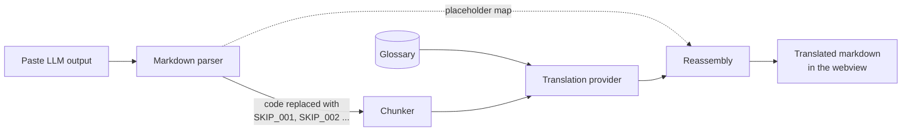

<div align="center">

# BhashaBridge

**Read LLM explanations in your own language. Code stays in English. Understanding becomes local.**

A VS Code extension that translates explanations from AI coding assistants into **Gujarati**, while keeping every line of code, variable name, and technical term exactly as it was.


</div>

---

## At a glance

<!-- Screenshot: add docs/images/panel.png (the panel with a translation, side by side) and replace this line with:
 -->

- **Code never changes.** Code is hidden before translation and put back letter for letter. If anything does not match, you get an error, never broken code.
- **Technical words stay English.** A glossary of 1,550+ terms in 32 domains keeps *array*, *API* or *dependency injection* as the words you will search for.
- **Learn as you read.** Click a paragraph to see its English, or read both side by side.
- **Works with any AI tool.** Select or copy an answer and press **Ctrl+Alt+Shift+T** (Cmd on Mac), paste it into the panel, or ask `@bhashabridge` in Copilot Chat.
- **Your code never leaves your machine.** Only the explanation, with code hidden, goes to the translator you choose: Sarvam AI with your own key, or your Copilot model.

**Install:** search for **BhashaBridge** in the VS Code Extensions view, or run `ext install SunilKapadia.bhashabridge` from the Quick Open box (Ctrl+P / Cmd+P). Then run **BhashaBridge: Set Sarvam API Key** (or use GitHub Copilot) and press **Ctrl+Alt+Shift+T** on any AI answer.

**Status:** 0.1.0 preview. Help is very welcome, especially from Gujarati speakers, and from anyone who wants to [add their own language](docs/ADDING_A_LANGUAGE.md). See [Contributing](#contributing).

More detail: [the idea in simple words](docs/SIMPLE_EXPLANATION.md) · [technical overview](docs/TECHNICAL_OVERVIEW.md)

## Why BhashaBridge?

Developers across Gujarat and the rest of India understand loops, functions, APIs, and data structures. But when Copilot or another assistant answers with three paragraphs of dense English explaining *why* the code is broken, the hard part stops being the bug and becomes the English.

Reading complex sentences in a second language while also reasoning about a technical fix is a heavy cognitive load. It slows learning and quietly tells talented developers that the tools were not built for them.

BhashaBridge removes that barrier. Paste the explanation, pick your language, and read it the way you think.

## What it looks like

**Input** (from any LLM tool):

> The `useEffect` hook runs after every render. Add an empty dependency array so that `loadData()` is called only once.

**Gujarati output:**

> `useEffect` hook દરેક render પછી ચાલે છે. ખાલી dependency array ઉમેરો જેથી `loadData()` ફક્ત એક જ વાર call થાય.

The explanation is translated. `useEffect`, `loadData()`, *render*, *dependency array*, and *call* are not, because those are the words you will search for, read in docs, and type in code.

*(Illustrative example. Real output depends on the translation provider.)*

## Principles

| | |
|---|---|
| **Code is never translated** | Code blocks, inline code, identifiers, library names, and technical keywords stay in English. Always. |
| **Bring your own key** | No BhashaBridge server. Your text goes only to the translation provider you choose, using your own API key. |
| **Provider freedom** | A common adapter interface lets you pick a backend by cost, quality, or privacy. |
| **Community glossary** | Which terms stay English and which get a local word is decided openly, through pull requests. |
| **Lightweight** | A small extension that sits alongside your existing assistant instead of replacing it. |

## How it works



1. **Parse.** The input is parsed into a markdown syntax tree. Every code block, inline code span and code line is swapped for a placeholder token such as `SKIP_001`, and the original is stored in a map.
2. **Protect terms.** Glossary terms are swapped for placeholders too, so they cannot be translated.
3. **Chunk.** Paragraphs are grouped into as few requests as fit the provider's limit; a paragraph that is too long is split at sentence ends.
4. **Translate.** Each request goes to the selected provider with a prompt that keeps technical terms in English. Every reply is checked: each placeholder must come back exactly once.
5. **Reassemble.** Translations and the exact original code are put back, byte for byte.
6. **Render.** The result is shown as sanitized HTML in the panel or the chat.

Because code is removed *before* translation, a model never gets the chance to "helpfully" translate your variable names.

## Supported languages and providers

| Language | Code | Status |
|---|---|---|
| Gujarati | `gu` | Available (preview) |
| Hindi, Kannada, Tamil, Telugu and others | | Not yet: [add your language](docs/ADDING_A_LANGUAGE.md) |

| Provider | Status |
|---|---|
| [Sarvam AI](https://www.sarvam.ai/) | Available, default (your own API key) |
| VS Code model (GitHub Copilot) | Available when Copilot is installed (no extra key) |
| [AI4Bharat IndicTrans2](https://github.com/AI4Bharat/IndicTrans2) | Planned, free alternative |
| Google Gemini | Planned |
| Krutrim | Planned |

## Project status

BhashaBridge 0.1.0 is a **preview** release on the VS Code Marketplace. See the [changelog](CHANGELOG.md).

- [x] **Milestone 0:** Project setup
- [x] **Milestone 1:** Extension skeleton with the `bhashabridge.translate` command and webview panel
- [x] **Milestone 2:** Markdown parser that extracts code into placeholder tokens
- [x] **Milestone 3:** Translation service (`TranslationProvider` interface and Sarvam adapter)
- [x] **Milestone 4:** Reassembly engine
- [x] **Milestone 5:** Webview UI (input, language and provider pickers, output)
- [x] **Milestone 6:** Secrets and settings
- [x] **Milestone 7:** Testing and first release (0.1.0 preview; see [`docs/PUBLISHING.md`](docs/PUBLISHING.md))

See [`docs/TASKS.md`](docs/TASKS.md) for the full breakdown.

## Getting started (development)

**Requirements:** Node.js 22+ and VS Code 1.90+.

```bash
git clone https://github.com/SkayKapadia/bhashabridge.git
cd bhashabridge
npm install
npm run bundle
```

Then open the folder in VS Code and press **F5**. In the window that opens:

1. Run **BhashaBridge: Set Sarvam API Key** from the Command Palette (`Ctrl+Shift+P` / `Cmd+Shift+P`) and paste a key from [dashboard.sarvam.ai](https://dashboard.sarvam.ai). With GitHub Copilot you can skip this and pick *VS Code model* instead.
2. Run **BhashaBridge: Translate LLM Output**, paste an AI answer, keep Gujarati selected, and click **Translate**.

### Scripts

| Command | What it does |
|---|---|
| `npm run compile` | Compile TypeScript to `out/` (used by the tests) |
| `npm run bundle` | Bundle the extension into `dist/extension.js` with esbuild (what F5 and the package run) |
| `npm run package` | Build `bhashabridge-<version>.vsix` for the Marketplace ([how to publish](docs/PUBLISHING.md)) |
| `npm run watch` | Recompile on every change |
| `npm run test:unit` | Run unit tests with Vitest |
| `npm test` | Compile, then run integration tests inside a downloaded copy of VS Code |
| `npm run quality` | Translate the 20 samples in `test/quality/samples` with the real Sarvam API and write a scored report to `docs/quality/`. Needs `SARVAM_API_KEY` in the environment or a git-ignored `.env` file. `-- --dry-run` checks the report without API calls. |
| `npm run glossary:review` | List the glossary renderings still to review in `docs/GLOSSARY_REVIEW.md` |

## Project structure

```
bhashabridge/
├── src/
│   ├── extension.ts      Entry point: registers commands and the chat participant
│   ├── parser/           Code extraction into placeholders, paragraph segments
│   ├── glossary/         Domain glossaries, term protection, workspace glossary
│   ├── chunking/         Grouping paragraphs into requests
│   ├── translation/      Provider interface, Sarvam and VS Code model adapters, the pipeline
│   ├── reassembly/       Putting translations and code back together
│   ├── webview/          The panel, safe rendering, learning mode
│   ├── chat/             @bhashabridge in the Chat view
│   ├── selection/        Translate Selection shortcut
│   └── settings/, secrets/, cache/, feedback/, quality/
├── media/                The panel's script and styles
├── glossary/domains/     32 domain glossary files
├── test/                 Unit tests, VS Code tests, quality samples
├── scripts/              Quality report and glossary review
└── docs/                 SDD, tasks, overviews, glossary review list
```

The [technical overview](docs/TECHNICAL_OVERVIEW.md) explains each part.

## Privacy and security

- **API keys** are stored with VS Code's encrypted SecretStorage. They are never written to settings files, never logged, and never sent anywhere but the provider you chose.
- **Your code never leaves your machine.** It is replaced by placeholders before anything is sent.
- **The explanation text** is sent only to the selected translation provider, over HTTPS.
- **No telemetry.** No analytics, no tracking, no BhashaBridge backend.
- **Locked-down webview.** A strict Content Security Policy blocks inline and external scripts, and translated output is sanitized before rendering.
- **Fully open source,** so anyone can audit exactly what happens to their text.

## The glossary

Some terms read best in English, and some have a natural local word. The glossary records that decision once, so translations stay consistent. It lives in `glossary/domains/`, one file per domain:

- **Software development** (on by default): programming fundamentals, web, backend, databases, cloud and DevOps, security, data and AI, mobile, testing, Git, networking, Agile, embedded and IoT, games, blockchain.
- **Business domains** (opt-in, for software built in these fields): supply chain, healthcare, finance and banking, insurance, e-commerce, education, manufacturing, government services, telecom, HR and payroll, marketing, legal, real estate, agriculture, energy, travel, media.

Pick domains with **BhashaBridge: Choose Glossary Domains**. Each term is treated one of three ways:

```json
{
  "keep": ["dependency injection", "callback", "UPI"],
  "annotate": { "ledger": { "gu": "ખાતાવહી", "reviewed": false } },
  "translate": { "inheritance": { "gu": "અનુવંશિકતા (inheritance)", "reviewed": false } }
}
```

- **keep**: always stays in English. This is guaranteed: the term is swapped out before translation, like code. Capitals-only terms (`IT`, `PO`) match only in capitals.
- **annotate**: stays in English, with its meaning added after the first use: "ledger (ખાતાવહી)".
- **translate**: the model is asked to use the given rendering.

**Your project's own terms:** run **BhashaBridge: Create Workspace Glossary** to add `.bhashabridge/glossary.json` to your project, in the same format. Use it for product names, internal acronyms and preferred translations. Its entries win over the built-in glossary, and edits apply to the next translation.

Gujarati renderings are used only once a native speaker marks them `"reviewed": true`; until then the term stays in English. `npm run glossary:review` lists the ones still to check in [`docs/GLOSSARY_REVIEW.md`](docs/GLOSSARY_REVIEW.md). Think a term is handled badly? Open a pull request.

## Roadmap

| Version | Highlights |
|---|---|
| **0.1.0** | Sarvam AI, Gujarati, basic webview, 100-term glossary, Marketplace release |
| **0.3.0** | IndicTrans2 and Gemini, streaming output, translation history, 300-term glossary |
| **0.5.0** | More languages from contributors (Hindi, Kannada, Tamil, Telugu and others); context from the open file; glossary voting |
| **1.0.0** | Full test coverage, terminal error translation, Continue.dev integration |
| **Beyond** | Voice output, browser extension for ChatGPT and Claude, CLI version |

## Contributing

Contributions are very welcome, especially from developers who think in Gujarati or another Indian language. You can help by:

- **Adding your language.** [`docs/ADDING_A_LANGUAGE.md`](docs/ADDING_A_LANGUAGE.md) walks through it, using Hindi as the example.

- **Improving the glossary.** Suggest how a technical term should be handled.
- **Reporting translation quality.** Share an explanation that came out wrong and what it should have said.
- **Adding a provider.** Implement the `TranslationProvider` interface for a new backend.
- **Testing with real output.** Try explanations from Copilot, Continue.dev, or ChatGPT and report what breaks.

See [CONTRIBUTING.md](CONTRIBUTING.md) for setup, the glossary rules and how reviews work. Every pull request is tested automatically.

## License

[MIT](LICENSE). Use it, change it, share it.

<div align="center">

**Built so that the next great developer from Rajkot or Nashik never has to fight the English to understand the code.**

</div>
