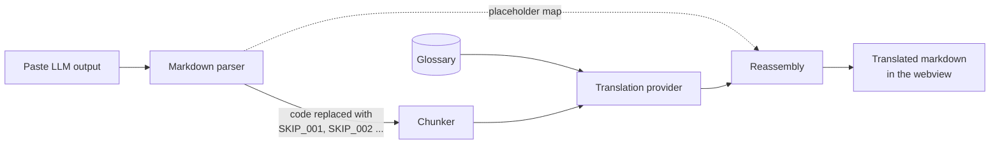

<div align="center">

# BhashaBridge

**Read LLM explanations in your own language. Code stays in English. Understanding becomes local.**

A VS Code extension that translates explanations from AI coding assistants into **Gujarati** and **Marathi**, while keeping every line of code, variable name, and technical term exactly as it was.


</div>

---

## Why BhashaBridge?

Developers across Gujarat, Maharashtra, and the rest of India understand loops, functions, APIs, and data structures. But when Copilot or another assistant answers with three paragraphs of dense English explaining *why* the code is broken, the hard part stops being the bug and becomes the English.

Reading complex sentences in a second language while also reasoning about a technical fix is a heavy cognitive load. It slows learning and quietly tells talented developers that the tools were not built for them.

BhashaBridge removes that barrier. Paste the explanation, pick your language, and read it the way you think.

## What it looks like

**Input** (from any LLM tool):

> The `useEffect` hook runs after every render. Add an empty dependency array so that `loadData()` is called only once.

**Gujarati output:**

> `useEffect` hook દરેક render પછી ચાલે છે. ખાલી dependency array ઉમેરો જેથી `loadData()` ફક્ત એક જ વાર call થાય.

**Marathi output:**

> `useEffect` hook प्रत्येक render नंतर चालतो. रिकामा dependency array जोडा म्हणजे `loadData()` फक्त एकदाच call होईल.

The explanation is translated. `useEffect`, `loadData()`, *render*, *dependency array*, and *call* are not, because those are the words you will search for, read in docs, and type in code.

*(Illustrative example. Real output depends on the translation provider.)*

## Principles

| | |
|---|---|
| **Code is never translated** | Code blocks, inline code, identifiers, library names, and technical keywords stay in English. Always. |
| **Bring your own key** | No BhashaBridge server. Your text goes only to the translation provider you choose, using your own API key. |
| **Provider freedom** | A common adapter interface lets you pick a backend by cost, quality, or privacy. |
| **Community glossary** | Which terms stay English and which get a local word is decided openly, through pull requests. |
| **Lightweight** | A small extension that sits alongside your existing assistant instead of replacing it. |

## How it works



1. **Parse.** The input is parsed into a markdown syntax tree. Every code block and inline code span is swapped for a placeholder token such as `SKIP_001`, and the original is stored in a map.
2. **Chunk.** Long text is split at paragraph and sentence boundaries to fit the provider's limits.
3. **Translate.** Each chunk is sent to the selected provider with a prompt that keeps technical terms in English and applies the glossary.
4. **Reassemble.** Placeholders are replaced with the exact original code, byte for byte.
5. **Render.** The result is shown in a webview with sanitized HTML and syntax highlighting.

Because code is removed *before* translation, a model never gets the chance to "helpfully" translate your variable names.

## Supported languages and providers

| Language | Code | Status |
|---|---|---|
| Gujarati | `gu` | Planned for v0.1.0 |
| Marathi | `mr` | Planned for v0.1.0 |
| Hindi, Kannada, Tamil, Telugu | | Later roadmap |

| Provider | Status |
|---|---|
| [Sarvam AI](https://www.sarvam.ai/) | Default, v0.1.0 |
| [AI4Bharat IndicTrans2](https://github.com/AI4Bharat/IndicTrans2) | Planned, free alternative |
| Google Gemini | Planned |
| Krutrim | Planned |

## Project status

BhashaBridge is in early development and is **not yet on the Marketplace**.

- [x] **Milestone 0:** Project setup
- [x] **Milestone 1:** Extension skeleton with the `bhashabridge.translate` command and webview panel
- [x] **Milestone 2:** Markdown parser that extracts code into placeholder tokens
- [x] **Milestone 3:** Translation service (`TranslationProvider` interface and Sarvam adapter)
- [x] **Milestone 4:** Reassembly engine
- [x] **Milestone 5:** Webview UI (input, language and provider pickers, output)
- [x] **Milestone 6:** Secrets and settings
- [ ] **Milestone 7:** Testing and first release

See [`docs/TASKS.md`](docs/TASKS.md) for the full breakdown.

## Getting started (development)

**Requirements:** Node.js 22+ and VS Code 1.90+.

```bash
git clone https://github.com/SkayKapadia/bhashabridge.git
cd bhashabridge
npm install
npm run compile
```

Then open the folder in VS Code and press **F5**. In the window that opens, run **BhashaBridge: Translate LLM Output** from the Command Palette (`Ctrl+Shift+P` / `Cmd+Shift+P`).

### Scripts

| Command | What it does |
|---|---|
| `npm run compile` | Compile TypeScript to `out/` |
| `npm run watch` | Recompile on every change |
| `npm run test:unit` | Run unit tests with Vitest |
| `npm test` | Compile, then run integration tests inside a downloaded copy of VS Code |
| `npm run quality` | Translate the 20 samples in `test/quality/samples` with the real Sarvam API and write a scored report to `docs/quality/`. Needs `SARVAM_API_KEY` in the environment or a git-ignored `.env` file. `-- --dry-run` checks the report without API calls. |
| `npm run glossary:review` | List the Gujarati and Marathi glossary renderings still to review in `docs/GLOSSARY_REVIEW.md` |

## Project structure

```
bhashabridge/
├── src/
│   ├── extension.ts      Entry point, registers commands
│   ├── parser/           Markdown parsing and code extraction
│   ├── translation/      TranslationProvider interface and adapters
│   ├── glossary/         Glossary loading and overrides
│   ├── secrets/          API key storage via SecretStorage
│   └── webview/          Webview panel UI
├── glossary/             Default Gujarati and Marathi glossaries
├── test/
│   ├── unit/             Vitest unit tests
│   └── integration/      VS Code extension tests
└── docs/                 Design doc (SDD), tasks, prompts
```

## Privacy and security

- **API keys** are stored with VS Code's encrypted SecretStorage. They are never written to settings files, never logged, and never sent anywhere but the provider you chose.
- **Your text** is sent only to the selected translation provider, over HTTPS.
- **No telemetry.** No analytics, no tracking, no BhashaBridge backend.
- **Locked-down webview.** A strict Content Security Policy blocks inline and external scripts, and translated output is sanitized before rendering.
- **Fully open source,** so anyone can audit exactly what happens to their text.

## The glossary

Some terms read best in English, and some have a natural local word. The glossary records that decision once, so translations stay consistent. It lives in `glossary/domains/`, one file per domain:

- **Software development** (on by default): programming fundamentals, web, backend, databases, cloud and DevOps, security, data and AI, mobile, testing, Git, networking, Agile, embedded and IoT, games, blockchain.
- **Business domains** (opt-in, for software built in these fields): supply chain, healthcare, finance and banking, insurance, e-commerce, education, manufacturing, government services, telecom, HR and payroll, marketing, legal, real estate, agriculture, energy, travel, media.

Pick domains with **BhashaBridge: Choose Glossary Domains**. Each term is treated one of three ways:

```json
{
  "keep": ["dependency injection", "callback", "UPI"],
  "annotate": { "ledger": { "gu": "ખાતાવહી", "mr": "खातेवही", "reviewed": false } },
  "translate": { "inheritance": { "gu": "અનુવંશિકતા (inheritance)", "mr": "अनुवांशिकता (inheritance)", "reviewed": false } }
}
```

- **keep**: always stays in English. This is guaranteed: the term is swapped out before translation, like code. Capitals-only terms (`IT`, `PO`) match only in capitals.
- **annotate**: stays in English, with its meaning added after the first use: "ledger (ખાતાવહી)".
- **translate**: the model is asked to use the given rendering.

**Your project's own terms:** run **BhashaBridge: Create Workspace Glossary** to add `.bhashabridge/glossary.json` to your project, in the same format. Use it for product names, internal acronyms and preferred translations. Its entries win over the built-in glossary, and edits apply to the next translation.

Gujarati and Marathi renderings are reviewed by native speakers. `npm run glossary:review` lists the ones still to check in [`docs/GLOSSARY_REVIEW.md`](docs/GLOSSARY_REVIEW.md). Think a term is handled badly? Open a pull request.

## Roadmap

| Version | Highlights |
|---|---|
| **0.1.0** | Sarvam AI, Gujarati and Marathi, basic webview, 100-term glossary, Marketplace release |
| **0.3.0** | IndicTrans2 and Gemini, streaming output, translation history, 300-term glossary |
| **0.5.0** | Hindi, Kannada, Tamil, Telugu; context from the open file; glossary voting |
| **1.0.0** | Full test coverage, terminal error translation, Continue.dev integration |
| **Beyond** | Voice output, browser extension for ChatGPT and Claude, CLI version |

## Contributing

Contributions are very welcome, especially from developers who think in Gujarati, Marathi, or another Indian language. You can help by:

- **Improving the glossary.** Suggest how a technical term should be handled.
- **Reporting translation quality.** Share an explanation that came out wrong and what it should have said.
- **Adding a provider.** Implement the `TranslationProvider` interface for a new backend.
- **Testing with real output.** Try explanations from Copilot, Continue.dev, or ChatGPT and report what breaks.

Fork the repo, create a branch, make sure `npm run test:unit` passes, and open a pull request.

## License

[MIT](LICENSE). Use it, change it, share it.

<div align="center">

**Built so that the next great developer from Rajkot or Nashik never has to fight the English to understand the code.**

</div>
