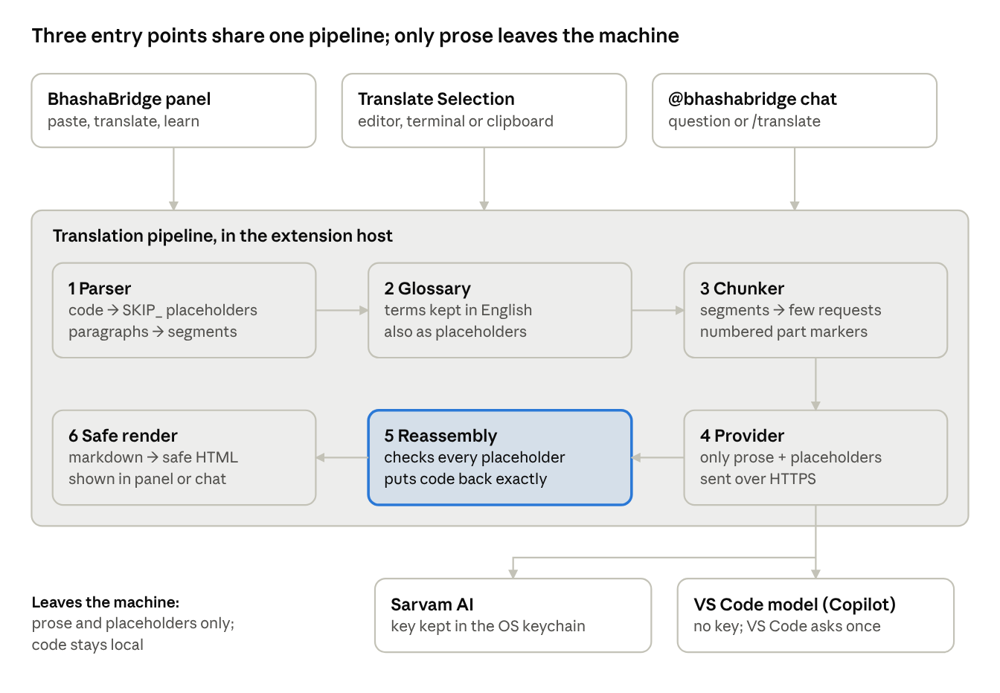

# BhashaBridge Technical Overview

October 20, 2026

> Local copy of the shared doc: https://claude.ai/code/artifact/eb0cdd64-8dc8-4aaa-897b-d825ddabdea3

## Overview

BhashaBridge is a VS Code extension that translates English explanations from AI coding assistants into Gujarati or Marathi while guaranteeing that code and technical terms come back unchanged. It is written in TypeScript, runs entirely in the VS Code extension host, and has no backend server: text goes only to the translation provider the user picks, with the user's own key.

**Design goals**

- Code is never translated: code blocks, inline code and bare code lines are removed before translation and restored byte for byte.
- Technical vocabulary stays consistent: a domain glossary guarantees which terms stay in English.
- Providers are swappable behind one interface (Sarvam AI and the VS Code language model today).
- Privacy by default: no telemetry, keys in the OS keychain, and code never leaves the machine.

**Status:** Milestones 0 to 6 of the task plan are complete, plus the glossary, chunking, chat participant, learning mode, cache, feedback and workspace glossary modules. 234 unit tests and 4 VS Code integration tests pass. Milestone 7 (packaging and publishing) is next.

## Architecture



All three entry points feed the same six-step pipeline in the extension host; only the provider step crosses the network, and it carries prose and placeholders, never code. Reassembly is the final guarantee that code comes back exactly.

## Request flow

A typical answer goes from paste to rendered Gujarati in one API call, with code protected at every step. Worked example:

```
The function fails because users is undefined. Add a check before calling map.
const names = users.map(getName);
```

1. **Panel → host.** The page posts `{ type: 'translate', text, language: 'gu', provider: 'sarvam' }`. The host validates it and aborts any request still running.
2. **Glossary.** Settings name the domains in use; the built-in domains are merged and the workspace glossary is applied on top.
3. **Parse.** The bare code line becomes `SKIP_001`; one segment is left: the sentence.
4. **Protect terms.** Glossary terms in the segment become placeholders numbered after the code tokens.
5. **Plan chunks.** One short segment, so one request with no markers.
6. **Cache check.** A SHA-256 key of provider, language, prompt and text; a hit returns at once.
7. **Translate.** One `POST` to Sarvam with the prompt and the segment. The adapter checks the reply is non-empty and every placeholder came back once.
8. **Restore terms and annotate.** Term placeholders go back to their English; annotated terms get their meaning after the first use.
9. **Reassemble.** The translated segment is spliced in by offset, then `SKIP_001` becomes `const names = users.map(getName);` exactly.
10. **Render.** The markdown becomes sanitized HTML plus the English/translation block pairs for learning mode, and both are posted to the page. The input folds into a one-line summary.

Progress messages (`Translating… 2 of 3 parts done`) are posted after each chunk. Any failure posts an error instead, and the pasted text stays in place.

## Markdown parser

The parser (`src/parser/markdownParser.ts`) turns pasted text into a version where every piece of code is a placeholder token, so the translator never sees code. It uses `mdast-util-from-markdown`, the parser behind remark, and works on exact source offsets so nothing outside the code is altered.

1. **Code blocks and inline code** are found in the syntax tree (`code` and `inlineCode` nodes), including fenced, tilde and indented blocks and code inside lists and quotes.
2. **Bare code lines** that were pasted without backticks look like ordinary paragraph text to a markdown parser. Each paragraph line is checked by `looksLikeCodeLine` (`src/parser/codeLine.ts`), which accepts lines such as `const x = …;`, `if (…) {`, closing braces, assignments, calls and Python `import`/`def` lines. Lines ending in `.` `?` `!`, or with three or more ordinary words in a row, are treated as prose.
3. **Placeholders** `SKIP_001`, `SKIP_002`, … replace each code span. A token that already appears in the input is skipped, so restoring never confuses user text with a placeholder.
4. **Segments** are the parts to translate: one per paragraph, heading or list item, each with its start and end offset in the replaced text. Lines that hold only placeholders are trimmed off, and a segment with no letters left is dropped.

**Layout is kept as written.** Markdown is read GitHub-style (tables, task lists, strikethrough), and each table cell is its own segment, so the table's `|` structure is never sent. Text copied from a rendered page is repaired first (`src/parser/normalizePaste.ts`): tab-separated lines become a table and `•` lines a list. The display keeps every line break. Bare web addresses and settings such as `"reviewed": false` are protected like code.

The result is `{ text, placeholders, segments }`. Restoring the placeholders into `text` gives back the original input character for character, which a test checks.

## Glossary

The glossary decides how technical terms are treated, and its main treatment is enforced in code rather than requested from the model. It lives in `glossary/domains/`, one JSON file per domain: 15 software development domains (on by default) and 17 business domains (opt-in), about 1,450 terms in total.

| Treatment | Effect | How it is applied | Example |
| --- | --- | --- | --- |
| keep | Always stays in English | Swapped for a placeholder before translation, like code | `dependency array`, `UPI`, `FHIR` |
| annotate | Stays in English, meaning added after the first use | Protected like keep; the meaning is inserted after translation | ledger → ledger (ખાતાવહી) |
| translate | Uses a set rendering | Listed in the prompt; the model writes it | inheritance → અનુવંશિકતા (inheritance) |

**Matching rules** (`src/glossary/protectTerms.ts`):

- Longest term first, so `dependency array` is protected as one unit before `array`.
- Whole words only, any capitalisation, with plurals (`s`, `es`, `y` → `ies`).
- A term written only in capitals (`IT`, `PO`, `PAN`) matches only in capitals, so ordinary words like "it" stay translatable.
- Gujarati and Marathi suffixes attach after the placeholder, so `SKIP_010ને` restores as `arrayને`.

**Review gate:** a built-in `annotate` or `translate` rendering is used only when it is marked `"reviewed": true`. Until then its term is treated as `keep`, so no unchecked Gujarati or Marathi reaches users. A workspace glossary's own entries are trusted unless marked `false`.

**Validation:** every file is checked on load. Ids must be unique, and a term listed in two domains must be treated the same way in both. A test also blocks ordinary words such as push, order or balance from the keep lists.

**Workspace glossary:** a project can add `.bhashabridge/glossary.json` with the same three sections. It is read on every translation, and its entries replace any built-in treatment of the same term.

## Chunking

Chunking packs segments into as few requests as fit the provider's size limit, so a typical answer is one API call instead of one per paragraph. The limit comes from the provider's optional `maxChunkChars` (Sarvam: 2,000 characters, VS Code model: 3,000, default 2,000), measured in characters because no tokenizer is available for these models.

- **Grouping** (`planChunks` in `src/chunking/chunker.ts`): segments are added in order until the next one would pass the limit.
- **Long paragraphs** are split at sentence ends (`.` `?` `!` and the Devanagari `।`), never mid-sentence and never inside `3.5` or `Node.js`. The original spacing is kept so the parts rejoin exactly.
- **Markers:** inside one request each segment follows a numbered line such as `<<<1>>>`, and the prompt tells the model to copy every marker. `splitChunkReply` accepts the reply only if markers come back exactly as sent.
- **Fallback:** if a marker is lost, merged or reordered, if a placeholder fails the provider's check, or if a placeholder moved from one part to another, that chunk is re-sent one segment at a time. The worst case costs what the old one-call-per-paragraph design cost, never wrong output.
- **Concurrency:** up to three chunks run at once; results go back into their own slots, so order holds. After the first failure no new chunk is sent.

## Translation providers

Every backend implements one small interface, so adding Claude, Gemini or IndicTrans2 later is a new class plus one entry in `PROVIDER_OPTIONS` (`src/translation/providers.ts`).

```ts
interface TranslationProvider {
  readonly id: string;              // 'sarvam', 'vscode-lm'
  readonly maxChunkChars?: number;  // size limit for the chunker
  translate(request: TranslateRequest, signal?: AbortSignal): Promise<TranslateResponse>;
}
// TranslateRequest  = { text, targetLanguage: 'gu' | 'mr', glossary? }
// TranslateResponse = { translatedText, tokenCount?, latencyMs? }
```

| Provider | Endpoint or API | Auth | Notes |
| --- | --- | --- | --- |
| Sarvam AI (`SarvamAdapter`) | `POST https://api.sarvam.ai/v1/chat/completions`, model `sarvam-105b` | User's key, sent as `api-subscription-key` and `Authorization: Bearer` | Reasoning is off (`reasoning_effort: null`): with it on, one paragraph spent all 4,096 tokens thinking and returned nothing. 30 s timeout. |
| VS Code model (`VscodeLmAdapter`) | `vscode.lm.selectChatModels({ vendor: 'copilot' })` | None; VS Code asks the user once | Shown in the dropdown only when a model exists. No system role, so the instructions lead the user message. 60 s timeout. |

Sarvam's translate API was considered and rejected: it accepts no instructions, so it cannot be told to keep technical terms in English.

**The prompt** (`src/translation/prompt.ts`) asks for the target language, keeps keywords, identifiers, library and framework names and technical terms in English, tells the model to copy every `SKIP_###` token and `<<<n>>>` marker exactly once, keep markdown, and reply with the translation only. Glossary `translate` entries are appended as a list.

**Each adapter checks the reply** before returning it: it must be non-empty, and every placeholder must appear exactly as many times as it was sent (`src/translation/placeholders.ts`).

## Reassembly and safety checks

Reassembly (`src/reassembly/reassemble.ts`) puts each translated segment back where its English stood, then restores the code, and refuses to return anything if code could be lost or duplicated.

1. **Splice segments** from last to first by their offsets, so heading marks, list bullets, quote markers and blank lines, which were never sent, come back untouched.
2. **Count placeholders.** Every token from the parser's map must appear exactly once. A missing, repeated or altered token (`SKIP_01`) raises a `ReassemblyError` naming it.
3. **Insert code verbatim** in one pass with a replacer function: `$&` or `$1` inside code stays literal, and code that itself contains the text `SKIP_002` is never scanned again.
4. **Keep code blocks valid markdown.** If the model pulled a block's token into a sentence, the block is moved back onto its own line (indented blocks get a blank line, which markdown requires there). Inline code always stays inline.

**Defence in depth:** the same code is protected at four points: placeholders before sending, the adapter's per-reply placeholder count, the chunker's per-part check, and reassembly's final count. A test runs a full document through a no-change translation and checks the output equals the input exactly.

## Webview UI and security

The panel is a VS Code webview whose page only displays HTML that the extension host has already sanitized, inside a policy that blocks every script but its own.

**What the panel has:** an input box that folds into a one-line summary after a translation (with Edit and New translation), language and provider dropdowns, a Translate button, a status line, an error box with Set key and Get a key buttons, the output, a Side by side toggle, and a Report translation button.

**Learning mode:** `renderBlockPairs` splits the English and the translation into top-level blocks and pairs them. Side by side shows them in two columns; otherwise clicking a translated block reveals its English. If the block counts ever differ, the two whole texts become one pair.

**Security model**

- **Rendering in the host:** markdown becomes HTML through `mdast-util-to-hast`, which drops raw HTML, then `hast-util-sanitize`, which strips `javascript:` and `data:` links and event handlers. Tests cover `<script>`, `<iframe>`, `onerror` and `onclick`.
- **Content Security Policy:** `default-src 'none'`; scripts and styles only from the extension's own `media/` folder. No inline script, nothing remote.
- **Untrusted messages:** every message from the page is validated in the host (`src/webview/controller.ts`): the language must be `gu` or `mr`, the provider must exist, the text must be a string.
- **Escaping:** provider names and setting values are escaped when the page is built; errors and labels are set as text, never HTML.

## Entry points

There are three ways in, and all of them use the same pipeline, settings and glossary (`src/settings/current.ts`).

| Entry point | How it is started | Where the text comes from | Where the result appears |
| --- | --- | --- | --- |
| Panel | BhashaBridge: Translate LLM Output | Pasted into the panel | The panel's output |
| Translate Selection | Ctrl+Alt+Shift+T (Cmd on Mac), or the editor right-click menu | Editor selection; terminal selection (copied first); otherwise the clipboard | The panel, filled in and translated at once |
| `@bhashabridge` chat | VS Code's Chat view (needs a chat extension such as GitHub Copilot) | A question, or text after `/translate` | The chat reply |

**Shortcut choice:** the SDD's Ctrl+Shift+B is VS Code's Run Build Task, so Ctrl+Alt+Shift+T is used instead. Three keybindings with different `when` clauses pass the text source to the command.

**Panel handshake:** a message posted before the page's script runs is lost, so the page sends `ready` first and the host holds any pending text until then.

**Chat participant:** for a question, the chat's Copilot model writes an English answer with code fenced and identifiers in backticks, which is exactly what the parser protects. The answer is then translated with the Default Provider, so a Sarvam user translates with their own key. Without a chat extension there is no Chat view and nothing is shown.

## Settings, keys and cache

Settings are read fresh on each translation, the API key never touches a settings file, and repeated requests are answered locally.

| Setting | Values | Default |
| --- | --- | --- |
| `bhashabridge.defaultLanguage` | `gu`, `mr` | `gu` |
| `bhashabridge.defaultProvider` | `sarvam`, `vscode-lm` | `sarvam` |
| `bhashabridge.glossaryDomains` | any of the 32 domain ids | the 15 software domains |
| `bhashabridge.workspaceGlossaryPath` | a path in the workspace | `.bhashabridge/glossary.json` |

A hand-edited bad value falls back to its default instead of breaking the panel. **Choose Glossary Domains** offers the domains as a checklist.

**API key:** stored in VS Code SecretStorage (the OS keychain) under `bhashabridge.sarvamApiKey`, set and cleared with two commands, read on every call so a new key applies at once. It is never logged, and if Sarvam's error text ever echoes it, the adapter replaces it with `[key hidden]`.

**Translation cache** (`src/cache/translationCache.ts`): `withCache` wraps each provider. The key is a SHA-256 of the provider id, language, the full prompt (so a changed prompt or glossary misses) and the text. Up to 200 entries are kept in VS Code's `globalState`, least recently used first out. Only successful translations are stored. Updates run one at a time from one shared instance, because three parallel chunks could otherwise overwrite each other's entries. **Clear Translation Cache** empties it.

## Error handling

Every expected failure is a `TranslationError` with a code and a message written for the person, and the pasted text is never lost (SDD error type 6).

| Code | When | What the person sees |
| --- | --- | --- |
| `input` | Under 10 characters (SDD error type 5) | Asked to paste more; no API call |
| `missing-key` | No Sarvam key saved | Message plus Set key and Get a key buttons; no API call |
| `invalid-key` | HTTP 401 or 403 | Message plus the two key buttons |
| `rate-limit` | HTTP 429 | Wait and try again |
| `timeout` | No answer in 30 s (Sarvam) or 60 s (VS Code model) | Try again |
| `network` | The request could not be sent | Check the connection |
| `placeholders` | A reply lost, repeated or changed a code placeholder | Try again; the chunker first retries part by part |
| `unavailable` | No VS Code model, or access refused | Install or sign in to Copilot, or pick Sarvam |
| `api` | Other HTTP errors, an empty reply, a cancelled request | The provider's own message |

A `ReassemblyError` (code could not be put back) and a `GlossaryError` (a bad glossary file, named with the term) are reported the same way. Anything unexpected shows a plain "Something went wrong" without internal details. Retries with exponential backoff, listed in the SDD, are not built yet.

## Testing and quality

234 unit tests and 4 VS Code integration tests pass, and none of them call a real API; real translation quality is measured separately with a scored report.

| Layer | Tool | What it covers |
| --- | --- | --- |
| Unit (`npm run test:unit`) | Vitest | Parser, code-line detection, glossary files and matching, chunker, both adapters with a stand-in network, prompt, reassembly, cache, rendering and sanitizing, settings, report links, chat logic |
| Integration (`npm test`) | `@vscode/test-electron` + Mocha | Activation, all commands registered, settings declared, Translate Selection and the panel opening, inside a downloaded VS Code |
| Quality (`npm run quality`) | `scripts/quality.mjs` | 20 realistic samples (16 software, 4 business) translated for real; automatic checks plus a 1 to 5 score column for a native speaker |
| Manual | Checklist (Milestone 7) | Clicks inside the panel, Copilot features, the shortcut in the terminal |

**Automatic quality checks** (`src/quality/checks.ts`): code unchanged, glossary terms still in English, no leftover placeholders or markers, and the same number of top-level blocks. They catch damage; how natural the language reads needs a person. The SDD target is an average score of 4.

**Glossary review:** `npm run glossary:review` lists every Gujarati and Marathi rendering not yet marked `"reviewed": true` in `docs/GLOSSARY_REVIEW.md` (82 today).

**Test environment note:** VS Code's own terminal sets `ELECTRON_RUN_AS_NODE=1`, which made the downloaded VS Code reject every flag. `test/runTest.ts` now clears it.

## Project structure

Each SDD module has its own folder under `src/`, and the parts that need VS Code are kept apart from the pure logic so the logic can be unit-tested directly.

| Path | Contents |
| --- | --- |
| `src/extension.ts` | Activation: registers every command and the chat participant |
| `src/parser/` | `markdownParser.ts` (code to placeholders, segments), `codeLine.ts` (bare code lines) |
| `src/glossary/` | `glossary.ts` (domain files, workspace glossary, merging), `protectTerms.ts` (matching, annotations) |
| `src/chunking/` | `chunker.ts` (grouping, sentence splitting, markers) |
| `src/translation/` | Provider interface, `sarvamAdapter.ts`, `vscodeLmAdapter.ts`, `providers.ts`, `prompt.ts`, `placeholders.ts`, `translateMarkdown.ts` (the pipeline), `errors.ts` |
| `src/reassembly/` | `reassemble.ts` (segments and code back in) |
| `src/webview/` | `panel.ts`, `panelHtml.ts`, `controller.ts`, `renderMarkdown.ts`, `messages.ts` |
| `src/chat/` | `chatHandler.ts` (logic), `participant.ts` (VS Code wiring) |
| `src/selection/` | Translate Selection (`readText.ts`, `translateSelection.ts`) |
| `src/settings/`, `src/secrets/`, `src/cache/`, `src/feedback/`, `src/quality/` | Settings and domain picker, key storage, translation cache, issue links, quality checks |
| `media/` | The panel's script and stylesheet |
| `glossary/domains/` | 32 domain glossary files |
| `test/unit/`, `test/integration/`, `test/quality/samples/` | Vitest tests, VS Code tests, 20 quality samples |
| `scripts/` | `quality.mjs`, `glossary-review.mjs` |
| `docs/` | SDD, tasks, glossary review list, quality reports, these overviews |

## Known limits and next steps

The code-safety guarantees are tested thoroughly; translation quality and the parts that need a human or Copilot are not yet measured.

**Known limits**

- Unusual code pasted without backticks can still be translated, because the bare-line rules are strict on purpose.
- Identifiers from the user's own code are protected only in backticks or on code lines; the glossary covers general terms.
- Sizes are measured in characters, not tokens, so the 2,000-character chunk limit is an estimate.
- No retries with backoff yet, and no streaming of partial results.
- Copilot features and clicks inside the panel are tested with stand-ins only.
- The 82 glossary renderings and the translation quality await native-speaker review.

**Next steps (Milestone 7)**

- [ ] Manual test checklist
- [ ] README written for users
- [ ] esbuild bundle and `.vscodeignore`, version 0.1.0, icon, CHANGELOG
- [ ] GitHub Actions running all tests on every push
- [ ] Publish to the VS Code Marketplace and Open VSX
- [ ] First real quality report scored by a native speaker
